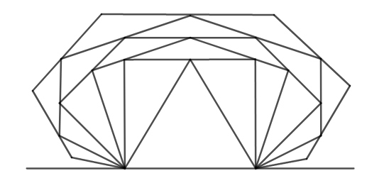
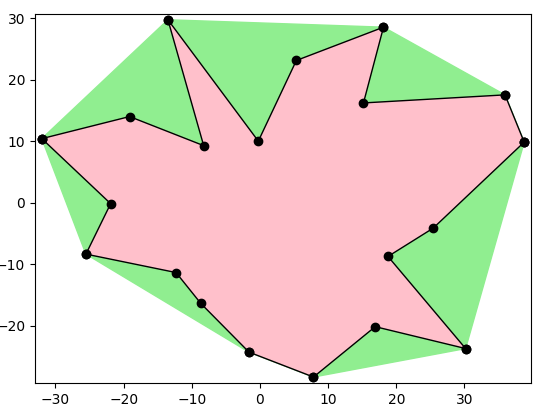
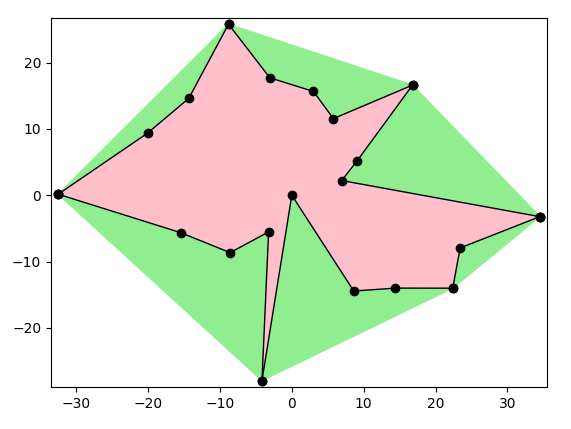
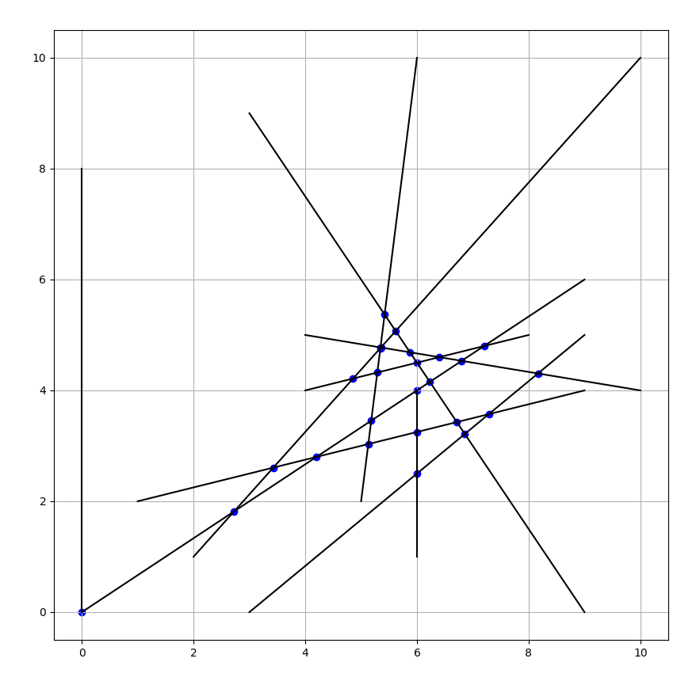
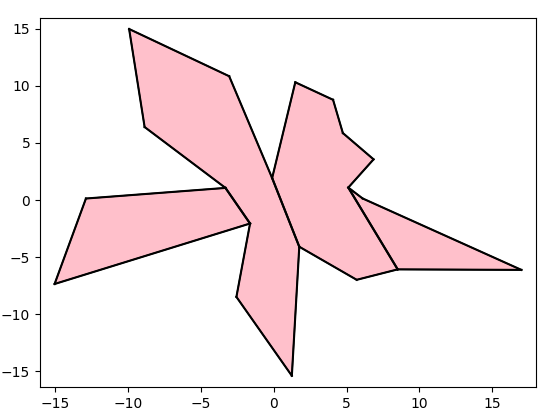
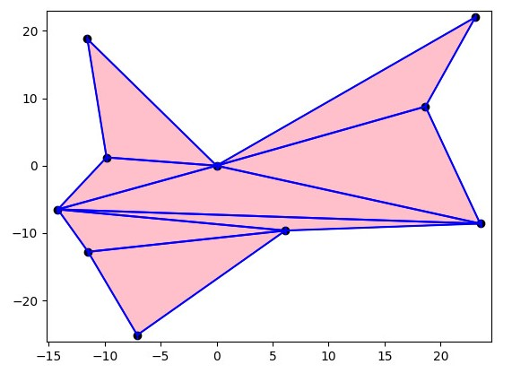
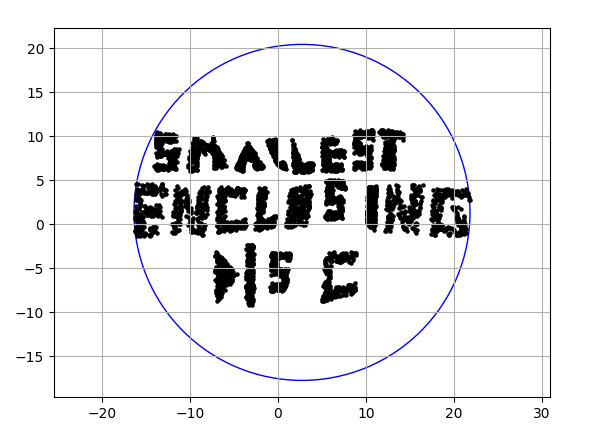

# CGEO

This project is a collection of several algorithms and applications of computational geometry.

It is built for quick and easy use of well-known performance-oriented algorithms and important data structures in the field of computational geometry in any Python program.

This is an ongoing project, some features are done and ready, and some are under construction.

## Features

You can find the followong algorithms available:

* [Convex Hull](https://github.com/tomsabala/CGEO/blob/main/src/2D/algorithms_2D/ConvexHull2D.cpp)
    * [Gift-Wrapping](https://en.wikipedia.org/wiki/Gift_wrapping_algorithm) Convex Hull by Jarvis march
    * [Grahm-Scan](https://en.wikipedia.org/wiki/Graham_scan) Convex Hull by Ronald Graham
    * Devide & Conquer Convex Hull
* [Segmentation Intersection](https://github.com/tomsabala/CGEO/blob/main/src/2D/algorithms_2D/SegmentIntersection2D.cpp)
* [Polygon Triangulation](https://github.com/tomsabala/CGEO/blob/main/src/2D/algorithms_2D/Triangulation2D.cpp)
* Shapes
    * 2D Basic Shapes
        * [Point](https://github.com/tomsabala/CGEO/blob/main/src/2D/shapes_2D/Point2d.cpp)
        * [Line](https://github.com/tomsabala/CGEO/blob/main/src/2D/shapes_2D/Line2d.cpp)
        * [Segment](https://github.com/tomsabala/CGEO/blob/main/src/2D/shapes_2D/Segment2d.cpp)
        * [Polygon](https://github.com/tomsabala/CGEO/blob/main/src/2D/shapes_2D/Polygon.cpp)
* [Balanced Binary Segment Tree](https://github.com/tomsabala/CGEO/blob/main/src/data_structures/SegmentBalancedTree.cpp)
* [Smallest Enclosing Disc](https://github.com/tomsabala/CGEO/blob/main/src/2D/algorithms_2D/SmallestEnclosingDisk.cpp)

All the algorithms are implemented using c++. 
But a user can use this source code as a C++ extension for a Python program.

The source code is wrapperd with [pybind11](https://pybind11.readthedocs.io/en/stable/), 
and you can find multiple code-examples of python programs with the wrapped package via the following [link](https://github.com/tomsabala/CGEO/tree/main/examples).

## Install

    pip install cgeo

Wheels are published for CPython 3.10–3.14 on Linux (x86_64, aarch64), macOS (arm64, x86_64) and
Windows (x86_64). No compiler required.

## Build from source

    git clone git@github.com:tomsabala/CGEO.git
    cd CGEO
    pip install -e ".[test]"
    pytest tests

The C++ core can also be built on its own, which produces the `cgeo_core` static library and the
`_cgeo` extension module:

    cmake -B build -DCMAKE_BUILD_TYPE=Release
    cmake --build build -j

<!--- 
## Some Nice Examples

      
Convex-Hull

      
 

   
   * The pink layer is the initial polygon form, and the green layer is the convex hull of the follow polygon.
     

      
Segement Intersection

      

   
   * The input is given as a list of segments, and the algorithms is coloring all segments intersections with blue.
     

      
Y-Monotone Polygons Decomposition

      

  
         
   * The pink layer is the initial polygon form, and the green layer is the convex hull of the follow polygon.
   * A [reference](https://en.wikipedia.org/wiki/Monotone_polygon) for y-monotone polygons definition.
   

      
Basic Polygon Triangulation

      

     

      
Smallest Enclosing Disc

      

     

-- >